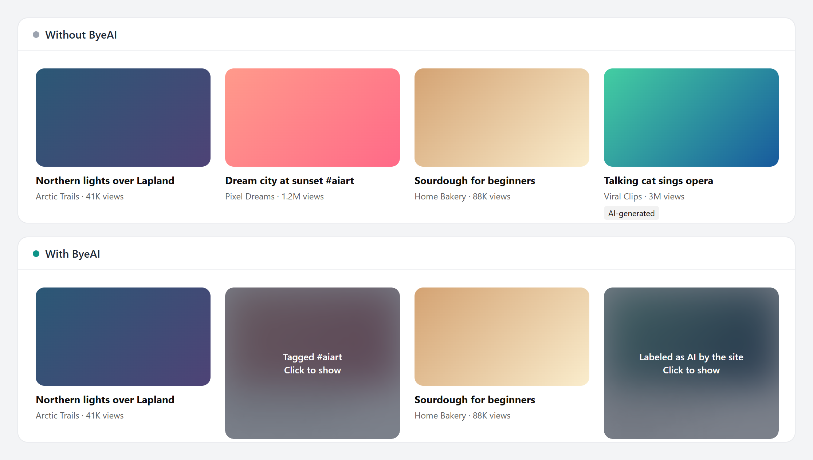

# ByeAI

[](https://chromewebstore.google.com/detail/byeai-block-ai-on-the-web/edlaekiaipaefekkomllmlhnmonpfbcl)
[](https://chromewebstore.google.com/detail/byeai-block-ai-on-the-web/edlaekiaipaefekkomllmlhnmonpfbcl)
[](https://github.com/El-SaMa/byeai/actions/workflows/ci.yml)

Block AI on the web. ByeAI stops chat widgets, copilots, AI Overviews and AI buttons before they load, and blurs videos and posts that sites label as AI. You choose which sites can use AI.

Like an ad blocker, but for AI.



## What it blocks


| Switch | What it does |
| --- | --- |
| Chatbots and AI search | Blocks chat widgets and copilots at the network level, hides Google AI Overviews, Bing Copilot, DuckDuckGo and Brave AI answers |
| AI buttons | Hides Grok, Meta AI, Gemini, Copilot, Rufus, "Help me write" and similar |
| AI videos and images | Blurs posts and videos that YouTube, TikTok, Instagram, Facebook, Threads, Pinterest and LinkedIn label as AI, or that carry clear AI tags like #aiart or #midjourney. Click to show one |

Any site can be allowed with one click.

## How it detects AI

- **Network rules** ([`extension/rules`](extension/rules)): `declarativeNetRequest` blocks known AI widget scripts and API hosts before they run.
- **Site labels**: platforms already mark AI content ("AI info", "Made with AI", "Altered or synthetic content"). ByeAI looks for those exact labels and covers the post or video they belong to. A sentence that only mentions AI is ignored.
- **Tags**: a short list of tags that almost always mean AI media. Broad tags like `#ai` are left out on purpose so news about AI stays visible.

No AI models, no guessing, no remote lists. Covers say why they are there.

## Privacy

Everything runs locally. ByeAI makes no network requests of its own, has no analytics and stores settings only in `chrome.storage.local`. Full policy: [privacy](https://el-sama.github.io/byeai/privacy.html).

| Permission | Why |
| --- | --- |
| `declarativeNetRequest` | Block AI scripts and API calls |
| `declarativeNetRequestFeedback` | Count what was blocked on the current tab |
| `storage` | Save your switches and allowed sites |
| `tabs`, `webNavigation` | Show per-tab counts, switch Google to Web results |
| Access to all sites | AI widgets can appear on any site |

## Verify a release

Store packages are built by [GitHub Actions](.github/workflows/release.yml) from the tagged commit, after the tests pass. Each [release](https://github.com/El-SaMa/byeai/releases) lists the SHA-256 of the zip that goes to the Chrome Web Store.

## Development

```
npm install
npm test
```

Load `extension/` as an unpacked extension in `chrome://extensions`. Tests run the real extension in Chromium against local copies of YouTube, X, Instagram, TikTok, Google and Amazon pages ([`tests/fixtures`](tests/fixtures)).

Found AI that slipped through? [Report it](https://github.com/El-SaMa/byeai/issues/new?template=missed-ai.yml). Security issues: see [SECURITY.md](SECURITY.md).

Built by [LAFU](https://lafu.fi). Published by Maximum Effort AY, Finland.
