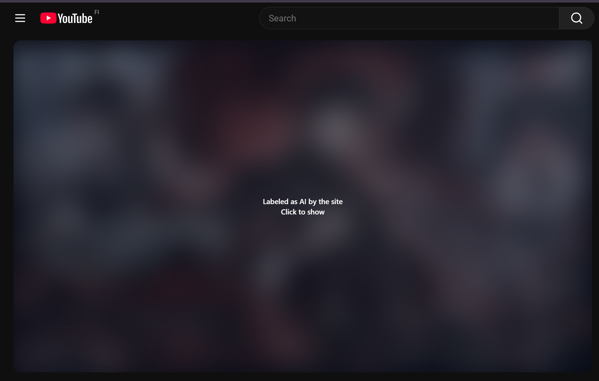
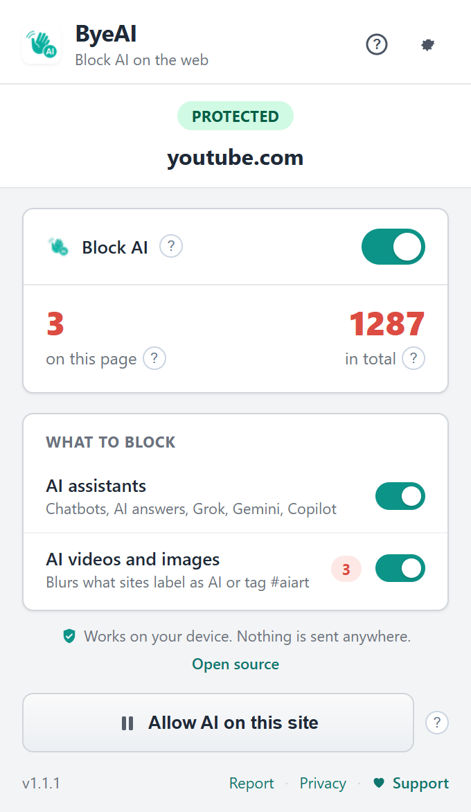

# ByeAI

[](https://chromewebstore.google.com/detail/byeai-block-ai-on-the-web/edlaekiaipaefekkomllmlhnmonpfbcl)
[](https://chromewebstore.google.com/detail/byeai-block-ai-on-the-web/edlaekiaipaefekkomllmlhnmonpfbcl)
[](https://github.com/El-SaMa/byeai/actions/workflows/ci.yml)

Block AI on the web. ByeAI stops chat widgets, copilots, AI Overviews and AI buttons before they load, and blurs videos and posts that sites label as AI. You choose which sites can use AI.

Like an ad blocker, but for AI.

<p align="center">
  
</p>

## What it blocks

| Switch | What it does |
| --- | --- |
| AI assistants | Blocks chat widgets and copilots at the network level, hides Google AI Overviews, Bing Copilot, DuckDuckGo and Brave AI answers, Amazon's AI review summary, and AI buttons like Grok, Meta AI, Gemini, Copilot, Rufus and "Help me write" |
| AI videos and images | Blurs posts and videos that YouTube, TikTok, Instagram, Facebook, Threads, Pinterest and LinkedIn label as AI, or that carry clear AI tags like #aiart or #midjourney. Click to show one |

AI apps you open yourself, like ChatGPT, Claude or Gemini, show a ByeAI page instead of loading, with **Allow this site** and **Allow once** buttons. The first time ByeAI blocks AI on a site, a small notice in the corner says so (turn it off in settings).

Any site can be allowed with one click, or you can show AI videos on just that site. Settings follow you to your other computers through Chrome sync.

<p align="center">
  
</p>

## Languages

30 languages, including Arabic and Persian with a right-to-left layout. English and Finnish are written by hand. The rest live as flat files in [`translations/`](translations) and are built with:

```
python scripts/build-locales.py
```

The script checks every key, placeholder and store length limit. Native speakers are welcome to send fixes.

## How it detects AI

- **Network rules** ([`extension/rules`](extension/rules)): `declarativeNetRequest` blocks known AI widget scripts and API hosts before they run.
- **Site labels**: platforms already mark AI content ("AI info", "Made with AI", "Altered or synthetic content"). ByeAI looks for those exact labels and covers the post or video they belong to. A sentence that only mentions AI is ignored.
- **Tags**: a short list of tags that almost always mean AI media. Broad tags like `#ai` are left out on purpose so news about AI stays visible.

No AI models, no guessing, no remote lists. Covers say why they are there.

## Privacy

Everything runs locally. ByeAI makes no network requests of its own and has no analytics. Settings live in `chrome.storage.sync` (Chrome's own sync, never our servers), counters and the list of sites that already showed the notice (up to 500) in `chrome.storage.local`, and "Allow once" in `chrome.storage.session` for that tab only. Full policy: [privacy](https://el-sama.github.io/byeai/privacy.html).

| Permission | Why |
| --- | --- |
| `declarativeNetRequest` | Block AI scripts and API calls |
| `declarativeNetRequestFeedback` | Count what was blocked on the current tab |
| `storage` | Save your switches and allowed sites, synced by Chrome |
| `webNavigation` | Switch Google searches to Web results so AI Overviews never load |
| Access to all sites | AI widgets can appear on any site |

## Verify a release

No `tabs` permission: site access already covers what the popup needs. CodeQL scans every push and Dependabot keeps the tooling current.

Store packages are built by [GitHub Actions](.github/workflows/release.yml) from the tagged commit, after the tests pass. Each [release](https://github.com/El-SaMa/byeai/releases) lists the SHA-256 of the zip that goes to the Chrome Web Store.

## Development

```
npm install
npm test
```

Load `extension/` as an unpacked extension in `chrome://extensions`. Tests run the real extension in Chromium against local copies of YouTube, X, Instagram, TikTok, Google and Amazon pages ([`tests/fixtures`](tests/fixtures)).

Found AI that slipped through? [Report it](https://github.com/El-SaMa/byeai/issues/new?template=missed-ai.yml). Security issues: see [SECURITY.md](SECURITY.md).

ByeAI is free and has no ads. If it helps you, you can [support it here](https://donate.stripe.com/14A8wO8mn3oA3N40Ge5EY00).

Built by [LAFU](https://lafu.fi). Published by Maximum Effort AY, Finland.
